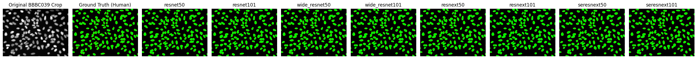
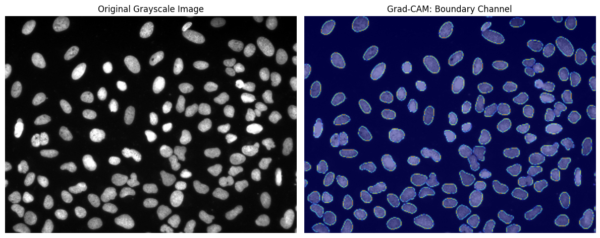
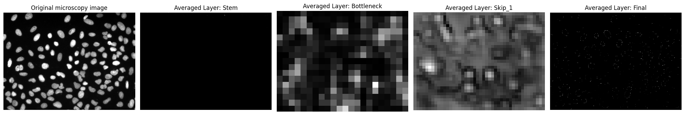
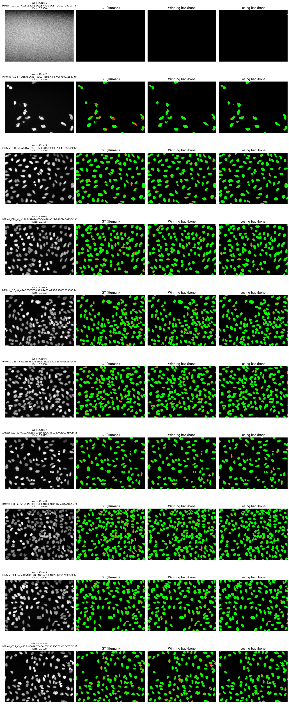

# Nucleus Segmentation in Fluorescence Microscopy

A benchmark of **8 heavyweight ResNet-family U-Net backbones** for nucleus instance segmentation on the [BBBC039](https://bbbc.broadinstitute.org/BBBC039) dataset — from pixel-level accuracy down to the metrics a biologist actually cares about, plus full interpretability analysis of the winning architecture.

## Research Question

High-throughput screening (HTS) runs thousands of biological experiments automatically and produces imaging data far beyond what humans can annotate by hand. The nucleus is the primary anchor point for analyzing a cell: segmenting each nucleus creates a **biological coordinate system** that enables cell counting, morphological measurements (nucleus swelling or fragmentation → cell death), and extraction of localized fluorescence intensities of targeted protein biomarkers for phenotypic profiling.

**Which ResNet backbone U-Net segments nuclei best?** The project compares:

| Family | Backbones |
|---|---|
| ResNet | ResNet-50, ResNet-101 |
| Wide-ResNet | Wide-ResNet-50, Wide-ResNet-101 |
| ResNeXt | ResNeXt-50, ResNeXt-101 |
| SE-ResNeXt | SE-ResNeXt-50, SE-ResNeXt-101 |

## Dataset

- **Source:** [BBBC039](https://bbbc.broadinstitute.org/BBBC039) — DAPI-stained nuclei, fluorescence microscopy, with RGBA annotation masks.
- **Preprocessing:** percentile-based normalization, multi-head target construction (background / boundary / interior channels).
- **Split:** 50 / 25 / 25 train–val–test, seed 42.
- **Augmentation:** random crops, flips, noise, elastic transforms (`albumentations`).
- The notebook downloads and extracts the dataset itself, so nothing needs to be committed to this repo.

## Method

### Architecture

- U-Net with `timm` `features_only` encoders (ImageNet-pretrained) and a 1-channel stem.
- **Multi-head decoder:** predicts 3 channels per pixel — background, boundary, interior.
- **Boundary-subtraction instance segmentation:** instead of watershed, predicted boundaries are subtracted from predicted interiors, isolating each discrete cell core:

```
pred_cores = (interior_prob > 0.5) & ~(boundary_prob > 0.5)
```

This directly addresses the classic failure mode where two touching nuclei merge into one blob — a mistake pixel-level metrics would barely penalize but which ruins cell counts.

### Loss

Combined Binary Cross Entropy + Dice loss to counteract the extreme foreground/background class imbalance:

$$L_{Total} = -\frac{1}{N}\sum_{i=1}^{N} \left[y_i \log(p_i) + (1-y_i)\log(1-p_i)\right] + \left(1 - \frac{2 \sum p_i y_i + \epsilon}{\sum p_i + \sum y_i + \epsilon}\right)$$

### Training Pipeline

- All 8 backbones trained under identical settings (split, loss, LR policy) for a fair comparison.
- **Crash-safe experiment manager:** full checkpoints (weights + optimizer + scheduler + epoch) every epoch, `training_progress.json` manifest, skip-finished / resume-interrupted logic, early stopping (patience 10), `ReduceLROnPlateau`.
- **Colab Drive persistence:** local fast checkpoints synced to Google Drive every 5 epochs — a runtime disconnect costs at most 5 epochs.
- Encoder/decoder get separate optimizer LR groups.

## Evaluation

Models are evaluated at two stages, then on biological and hardware benchmarks:

### Semantic (pixel-level)
- **Dice coefficient (F1)** — industry standard for medical imaging, robust to class imbalance.
- **IoU (Jaccard)** — stricter; penalizes false positives/negatives more harshly.

### Instance (object-level)
- **mAP across IoU thresholds** (0.50 → 0.95, step 0.05) — the 2018 Data Science Bowl metric; over-split nuclei instantly trigger false-positive penalties.

### Biological benchmarks (what a biologist cares about)
- **Absolute cell count error** — how close detected counts are to ground truth.
- **Morphological variance** — Kolmogorov–Smirnov (KS) test on area and eccentricity distributions of predicted cells vs. human annotations.

### Hardware benchmarks
- Training time per model and peak VRAM.
- **Avg prediction time per model (ms/image)** — GPU-synchronized forward-pass timing, measured separately from CPU postprocessing.
- **Winner-vs-loser avg prediction time difference** — the interpretability setup auto-selects the winning (lowest val loss) and losing (highest val loss) models from the training manifest and reports the speed delta.

## Interpretability

"Black box" networks face heavy criticism in biomedical settings — biologists and regulators want to know *why* a prediction was made. Three analyses run automatically on the finished models:

1. **Grad-CAM** — gradient-weighted heatmaps over the original microscopy images, targeting the boundary channel. If the model learned real biology, the heatmap glows as a ring around the nucleus rather than highlighting background noise or sensor artifacts.
2. **Feature-map extraction** (PyTorch hooks) — grayscale plots from three locations: the ResNet stem (edge detectors), the encoder bottleneck (abstract semantic concepts), and the skip connections (high-resolution edges bypassing the bottleneck).
3. **Comparative error analysis** — test images sorted by worst image-level Dice, directly comparing the winning model's failure modes against the losing models to reveal architectural nuances (e.g., failure on dense overlapping clusters).

## Project Structure

```
├── src/
│   ├── Nucleus_Segmentation_in_Fluorescence_Microscopy.ipynb   # Full pipeline (Colab-ready)
│   ├── config.py                                                # Path configuration
│   ├── utils/dirtools.py                                        # File/IO utilities
│   └── dataset/                                                 # BBBC039 (gitignored, auto-downloaded)
├── tests/
│   └── test_checkpointing.py                                    # 4 regression scenarios for the training loop
├── model_evaluation_and_interpretability.md                     # Step-by-step explainer of every evaluation block
└── rationale_and_methodology.txt                                # Research rationale and metric derivations
```

## Quick Start

### Google Colab (recommended — GPU)

1. Open `src/Nucleus_Segmentation_in_Fluorescence_Microscopy.ipynb` in Colab.
2. Run the setup cell (installs dependencies, mounts Google Drive for checkpoints).
3. Choose a path:
   - **Option A — train:** run the data, model, and training sections. Training is fully resumable; re-running picks up where it left off.
   - **Option B — use finished models:** skip training. The loader lists Drive checkpoints and loads the best weights so evaluation and interpretability run without re-training.
4. Run the benchmarking and interpretability cells — the setup cell auto-selects the winning and losing models from `training_progress.json`.

### Local development

```bash
python tests/test_checkpointing.py   # 4/4 regression scenarios for checkpoint/resume/early-stopping logic
```

Dependencies: `torch`, `torchvision`, `timm`, `albumentations`, `tifffile`, `scikit-image`, `opencv-python` (installed automatically by the notebook's setup cell).

## Documentation

- [model_evaluation_and_interpretability.md](model_evaluation_and_interpretability.md) — what each evaluation/interpretability block is, how it works step by step, and why it exists.
- [rationale_and_methodology.txt](rationale_and_methodology.txt) — research motivation and metric derivations.

## Results

All 8 backbones were trained on Colab (Google Drive checkpoints) and evaluated on the held-out test split (25%, seed 42). Ground truth: **6,162 nuclei**.

### Final Biological & Hardware Benchmark

| Backbone | Avg Prediction Time | Inference VRAM | Nuclei Detected | Count Error ↓ | Area KS ↓ | Eccentricity KS ↓ |
|---|---|---|---|---|---|---|
| **wide_resnet50** 🏆 | 13.88 ms/img | 4823.96 MB | 5309 | **853** | **0.0951** | 0.0378 |
| seresnext101 | 20.92 ms/img | 4824.58 MB | 5297 | 865 | 0.0973 | **0.0361** |
| resnext50 | **12.49 ms/img** | 4824.58 MB | 5295 | 867 | 0.0987 | **0.0361** |
| resnet50 | 52.63 ms/img* | 4824.40 MB | 5268 | 894 | 0.1068 | 0.0401 |
| seresnext50 | 15.07 ms/img | 4824.96 MB | 5260 | 902 | 0.1030 | 0.0404 |
| resnet101 | 13.04 ms/img | 4823.96 MB | 5186 | 976 | 0.1209 | 0.0479 |
| wide_resnet101 | 16.31 ms/img | 4825.55 MB | 5161 | 1001 | 0.1177 | 0.0458 |
| resnext101 | 20.91 ms/img | 4824.58 MB | 5161 | 1001 | 0.1327 | 0.0431 |

Sorted by absolute cell count error (lower is better).

\* resnet50 was the first model evaluated, so its forward pass absorbed CUDA warm-up/autotune costs — its 7.46 s total inference time vs. ~5 s for the others shows the same effect. Its true speed is comparable to the other 50-layer backbones.

> **Note:** the pixel-level Dice/IoU and instance-level mAP evaluation cells are not implemented yet (see the explainer); this run covers the biological and hardware benchmarks.

### Winner vs. Loser (auto-selected from the training manifest)

The interpretability setup cell picks the models with the lowest and highest best validation loss from `training_progress.json`:

| | Model | Best Val Loss | Avg Prediction Time (warm-up excluded) |
|---|---|---|---|
| 🏆 Winner | **wide_resnet50** | **0.1317** | **16.61 ms/image** |
| Loser | resnext101 | 0.1424 | 22.86 ms/image |

**The winner is also 6.25 ms/image faster (1.38× speedup)** — wide_resnet50 wins on accuracy *and* speed.

### What the results say

- **Every backbone under-segments.** All 8 predict 5,161–5,309 nuclei vs. 6,162 ground truth (~14% undercount). The min-size filter drops small nuclei and boundary-subtraction can merge tightly packed clusters — the error is systematic across all architectures, not specific to one.
- **The margins are small.** Validation losses span only 0.1317–0.1424 and the biological metrics cluster tightly — **on an eye test the predicted masks from different backbones are essentially indistinguishable**. That is itself a finding: on BBBC039, the U-Net + multi-head design dominates, and backbone choice matters most in the tails — the KS statistics and the pathological cases.
- **wide_resnet50 wins the tie-breakers that matter biologically:** lowest count error (853), best area-distribution match (KS 0.0951), best validation loss — and it is faster than the loser.
- **The comparative error analysis** (below) shows where the models actually differ in practice, by ranking test images from worst to best image-level Dice.

### Training Curves



### Interpretability — Winning Model (wide_resnet50)

**Grad-CAM** — gradients flowing back from the boundary channel form a ring around the nucleus rather than highlighting background noise, i.e., the model is looking at true biology:



**Feature maps** — averaged activations from the ResNet stem (edge detection), the encoder bottleneck (abstract semantics), the first skip connection (high-resolution edges bypassing the bottleneck), and the final multi-head output:



**Comparative error analysis** — the test images the winning model scored worst on, isolating pathological cases (e.g., dense overlapping clusters) where architectural differences show up:


